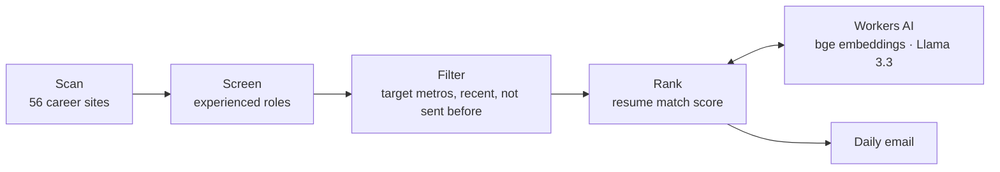

# Job Search Agent

A daily job-hunting agent for experienced software engineers. Every evening it checks 81 tracked companies (56 auto-readable), filters out entry-level roles, ranks newly posted matches against my resume with Workers AI (embeddings + Llama 3.3), and emails the results using GitHub Actions.

**Stack:** TypeScript · Node · Cloudflare Workers AI · GitHub Actions · automated tests

**Target locations:** major US metros (including US-based remote jobs); in China, **Shanghai and Hangzhou only**. The scheduled workflow uses `ALERT_TARGET_LOCATIONS=US_MAJOR_METROS, Shanghai, Hangzhou` by default. The old `ALERT_LOCATIONS` repository variable was removed in the 2026-11-12 cleanup. Update `ALERT_TARGET_LOCATIONS` to customize.

Job listings with a missing location or a Workday placeholder such as `2 Locations` remain candidates for manual location verification. The daily digest catches recently posted jobs (3-day default) rather than monitoring older postings indefinitely.

**JD Archive MVP (opt-in):** [RFC 0001 — JD Intelligence](docs/rfcs/0001-jd-intelligence.md) defines the broader design. With a `JD_INTEL_KEY` secret (a unique random passphrase of at least 32 characters), the **same daily scan** also selects up to 10 unique infrastructure-relevant JDs and writes only a minimized AES-256-GCM encrypted artifact retained for 30 days by GitHub Actions. It does **not** commit JD archives or raw job descriptions to Git, and does not modify the email seen-state. The archive still runs when there are no new jobs to email. Without `JD_INTEL_KEY`, daily email is unchanged and archive creation is skipped. `--dry-run` and `--test-email` never write an archive. The artifact is private to repository Actions access; people with the secret can decrypt it. **Skill trend analysis and cross-repo PR creation are not yet implemented** (later PRs). To enable, add a GitHub Actions repository secret named `JD_INTEL_KEY` using a strong independently generated random passphrase.

**查看加密归档：** 在 GitHub Actions 的每日 Job alerts run 下载名为 `jd-intelligence-YYYY-MM-DD` 的 Artifact，解压后得到 `jd-intelligence-slot.enc`。在你自己的电脑上，`.env` 配置同一个 `JD_INTEL_KEY`，执行 `npm run jd-archive:view -- /path/to/jd-intelligence-slot.enc`。命令仅在本地输出 Top 10 职位、相对匹配分数、地点和有限的技术关键词；**不要在公开 Actions 日志中运行解密命令**。当前关键词仅代表 JD 中提及，并不声称是 Required Qualifications；更精确的 Required/Preferred 分析属于后续 PR B。

**Verify changes:** `npm test` and `npm run typecheck`. See `FORK_NOTES.md` for fork-specific behavior and security notes.

**Company coverage:** 81 tracked companies; 56 have public ATS/custom readers, while 25 are manual-only. The eight latest Greenhouse/Ashby feeds are tested live in `.github/workflows/source-smoke.yml`. The company list is a watchlist, not a guarantee of better compensation or a match in every city.
