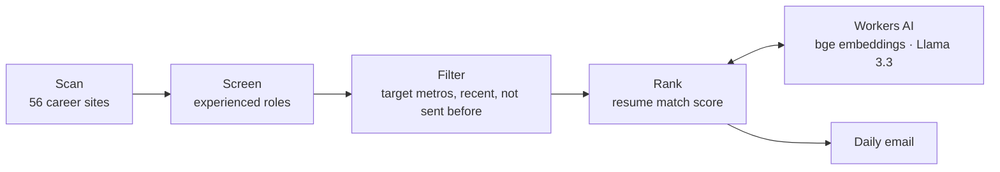

# Job Search Agent

A daily job-hunting agent for experienced software engineers. Every evening it checks 81 tracked companies (56 auto-readable), filters out entry-level roles, ranks newly posted matches against my resume with Workers AI (embeddings + Llama 3.3), and emails the results using GitHub Actions.

**Stack:** TypeScript · Node · Cloudflare Workers AI · GitHub Actions · automated tests

**Target locations:** major US metros (including US-based remote jobs); in China, **Shanghai and Hangzhou only**. The scheduled workflow uses `ALERT_TARGET_LOCATIONS=US_MAJOR_METROS, Shanghai, Hangzhou` by default. The old `ALERT_LOCATIONS` repository variable was removed in the 2026-11-12 cleanup. Update `ALERT_TARGET_LOCATIONS` to customize.

Job listings with a missing location or a Workday placeholder such as `2 Locations` remain candidates for manual location verification. The daily digest catches recently posted jobs (3-day default) rather than monitoring older postings indefinitely.

**Verify changes:** `npm test` and `npm run typecheck`. See `FORK_NOTES.md` for fork-specific behavior and security notes.

**Company coverage:** 81 tracked companies; 56 have public ATS/custom readers, while 25 are manual-only. The eight latest Greenhouse/Ashby feeds are tested live in `.github/workflows/source-smoke.yml`. The company list is a watchlist, not a guarantee of better compensation or a match in every city.
