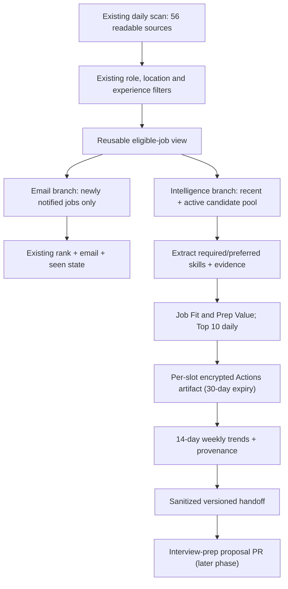

# RFC 0001: JD Intelligence — daily evidence, weekly interview signals

- **Status:** Proposed (design only; no runtime behavior changed)
- **Date:** 2026-11-12 (America/Chicago)
- **Owner:** Job Search Agent
- **Partner:** [interview-prep](https://github.com/BlueSaNGG/interview-prep)
- **Review scope:** data contract, lifecycle, privacy, ranking, reliability, test plan
- **Implementation:** separate PRs after design review

## 1. Problem and goals

The existing watcher scans 56 automatically readable sources across 81 tracked employers, filters experienced software jobs in major US metros and Shanghai/Hangzhou, scores **new email candidates** against the resume, and sends an evening digest. Email novelty is not the same as interview-preparation value: a still-open JD may teach us something even when it should not trigger another email.

Goals:

1. **Daily:** preserve a deduplicated, structured Top 10 set of relevant **JD signals** from the *same* scan used for alerts; no extra crawl of all 56 sources.
2. **Rolling 14 days:** identify recurrent skill requirements *among the sampled relevant JDs*, with traceable job IDs/URLs, without pretending to measure the whole labor market.
3. **Weekly:** produce a versioned, privacy-safe handoff to interview-prep for a human-reviewed study-plan PR.
4. Maintain separate **Job Fit** (application readiness) and **Prep Value** (value of studying this gap) rankings; respect compensation and career-upside uncertainty.
5. Keep existing email delivery and existing interview-prep mastery records independent.

Non-goals for v1: scraping the 25 manual-only employers; applying to jobs; changing candidate location policy; guaranteeing compensation upside; replacing a learning curriculum; predicting interview questions; automatically merging study PRs.

## 2. Design overview



**Single scan:** one result set is fanned out before email-specific `pickNewJobs` and first-run/undated suppression. A zero-new-email day may still produce a snapshot from the active/recent candidate pool. The digest must not change merely because intelligence fails.

**Separation of responsibilities:** this repository owns job collection, normalization, extraction, scores and source provenance. Interview-prep owns interpretation against real learning records and proposed study actions.

### Current-code constraints

- `src/node/alerts.ts` currently calls `rankJobs` only on `toSend`. Intelligence must not use that email-only list for its complete candidate universe.
- `src/core/discover/discover.ts` holds at most 4,000 characters of a matched JD when `keepDescription` is enabled; `src/core/rank.ts` embeds the first ~1,800 characters. Required qualifications may be later. Add a bounded extraction path operating on complete description **in memory** when the source provides it, without copying full JD text into the archive.
- Existing Workday count-only or missing locations remain eligible for manual review in alerts. Intelligence must carry a `location_status=needs_review` flag and must never confidently classify such a job as Shanghai/Hangzhou or a US metro.
- Existing `.github/workflows/alerts.yml` runs in the Chicago daily slot and commits encrypted seen state. Reuse the same slot/scan/concurrency; do not create a second full-scan cron.

## 3. Data contract (schema v1)

Each normalized record is an **observation** of a public posting, not a claim that applying is currently possible. Example is fictional:

```json
{
  "schema_version": 1,
  "id": "airwallex:example-req",
  "company_id": "airwallex",
  "company_name": "Airwallex",
  "title": "Software Engineer, Developer Productivity",
  "url": "https://example.com/official-job-link",
  "location": "Shanghai, China",
  "location_status": "eligible",
  "posted_at": null,
  "first_seen_at": "2026-11-12T00:00:00Z",
  "last_seen_at": "2026-11-12T00:00:00Z",
  "observed_slot": "2026-11-12",
  "content_hash": "sha256-of-normalized-source-content",
  "description_status": "complete",
  "skills": [
    {
      "id": "build_systems",
      "label": "Build systems",
      "requirement": "required",
      "evidence": "Build/test pipeline ownership described in requirements",
      "section": "requirements"
    }
  ],
  "scores": {
    "job_fit": 84,
    "prep_value": 73,
    "career_upside": "unknown"
  },
  "compensation": {
    "status": "not_stated",
    "currency": null,
    "period": null,
    "minimum": null,
    "maximum": null
  },
  "score_version": "fit-v1/prep-v1",
  "manual_review": []
}
```

Fields and invariants:

- `id` = existing company ID + stable ATS job ID; stable URL fallback is only for feeds without IDs. `content_hash` is SHA-256 of normalized relevant source content, excluding volatile timestamps and tracking parameters. Same ID + changed hash = updated version, not a new role.
- `posted_at` is nullable (never fill with `first_seen_at`). `first_seen_at` and `last_seen_at` reflect **our observations**, not employer publication dates.
- `location_status` is one of `eligible`, `needs_review`, `excluded`. Only known-eligible jobs can be counted as location-verified market evidence; ambiguous jobs can appear in a clearly labeled review queue.
- `description_status` = `complete`, `partial`, `unavailable`; skill evidence from missing/partial content is not silently upgraded to a verified requirement.
- `skills[].requirement` = `required`, `preferred` or `mentioned`; `evidence` is a short **paraphrase** plus source section and original URL, not the full JD.
- `compensation.status` = `stated`, `not_stated`, `unparseable`. Do not infer China TC from US salary parsing; do not estimate bonus/equity from company reputation. Unknown compensation remains unknown.
- `job_fit` and `prep_value` are nullable integers 0–100, each with a `score_version`. They are priority heuristics, not calibrated probabilities or salary predictions.
- An archive record does **not** contain the resume text, credentials, private employer materials, AI prompts, raw JD body, or a candidate's personal history.

A separate daily manifest records `slot`, counts (companies succeeded/failed, qualifying jobs, missing descriptions, candidates considered, archived), selected IDs, extraction/score versions, failures and truncated-budget markers. A weekly export uses an explicit versioned schema and references the selected IDs and public job URLs.

## 4. Candidate selection, ranking and evidence

1. Start with the full collected set **before** email seen/recency selection; apply existing role, experienced-level, location and (where valid) compensation rules once. Never silently force 110k USD salary on Chinese JDs.
2. Form a bounded candidate pool from roles first-seen/updated within 14 days plus the previously selected active shortlist. Do not score all historical jobs every night. Deduplicate by stable `id`; on repeated scans reuse skill extraction when `content_hash` and extraction version are unchanged.
3. Rank the sampled pool for two different questions:
   - **Job Fit:** resume embedding relevance plus explicit role/experience constraints; reuse the present score concept and display it as relative similarity only.
   - **Prep Value:** normalized requirement strength, recurrence across *distinct companies*, gap supported by interview-prep evidence when available, job relevance, and learnability. If the learning profile is unavailable, label `prep_value=null` or `provisional`, rather than inventing mastery.
4. Select **up to 10 unique JDs per Chicago slot**: 5 best Job Fit + 5 best available Prep Value (fill unused slots from other score). Apply max 2 per company where possible, deterministic tie-breaking by score, company, ID. Do not manufacture a China quota when automated China coverage is scarce.
5. Extract a bounded set of skills and their section/provenance; distinguish explicit required vs preferred vs loose mention. Normalize synonyms (e.g. CI/CD, build pipeline; K8s, Kubernetes) under a **versioned skill taxonomy**. Unknown skills remain unclassified, not erased.
6. No new jobs or AI outage: emit a truthful manifest, retain previous archive, and never present unscored candidates as scored. An LLM output must pass schema/size validation; deterministic extraction/fallback and an error count must remain available.

**Anti-bias:** weekly trends count distinct posting IDs and separately distinct companies. Report the actual denominator (`N` sample jobs, `M` companies). Limit overrepresentation by company and explicitly label findings as **sampled prioritized opportunities**, not universal market trends. Link every suggested skill to supporting JD IDs.

### Existing learning profile is authoritative elsewhere

The job-search repository must not mutate interview-prep. In v1 `prep_value` may be provisional because it has no reliable mastery state yet. The weekly integration stage is responsible for recalculating or annotating prep value using interview-prep `tracking/current.json`, `exercises/*/meta.json`, exercise evidence, and project stories. “Read” and “studied” do not imply “independently mastered.” Keep the original Job Fit score separate from all learning scores.

## 5. Persistence and privacy

**Decision: store each day’s minimized, encrypted observations as a separately expiring GitHub Actions artifact, never as a Git-tracked archive. Publish only sanitized weekly evidence.**

- For each Chicago daily slot, create a **separate minimized encrypted observation bundle** and daily manifest (e.g. `jd-intelligence-2026-11-12.v1.enc`) and upload it using `actions/upload-artifact@v4` with `retention-days: 30`. **Never commit daily JD archives to Git.** The temporary plaintext JSON exists only inside the runner working directory with restrictive permissions, is removed before job completion, and must never be uploaded, added to Git, or logged. Artifact contents are ciphertext only.
- Read the prior <=30 daily artifacts via GitHub Actions artifact APIs (explicit `actions: read` permission) to build a rolling view and a 14-day weekly sample. Do not copy old observations into newer artifacts merely for rolling storage: repeating their bytes in today's artifact would extend their effective retention. De-duplicate and aggregate in memory. A same-slot rerun may produce multiple artifact runs; select the newest **successful, schema-valid** artifact per slot deterministically and report superseded duplicates.
- Enforce the 30-day artifact lifecycle via GitHub's configured artifact expiry and test that an older artifact cannot be used for current evidence. This is a platform retention policy, **not a guarantee of immediate physical erasure or legal-grade deletion**; use a dedicated lifecycle-controlled private data store instead if strict deletion attestations become a requirement. Old artifacts must not be accessible as Git commits or long-lived Actions artifacts. The only durable Git output is the minimized, human-reviewable weekly report. Keep the **existing** `.data/alerts-seen.json.enc` email dedup state unchanged; it is a separate legacy function and is not part of JD retention.
- Use a dedicated `JD_INTEL_KEY` repository secret for Node AES-256-GCM with unique nonce and versioned envelope; reject missing/invalid keys. Reusing the existing `STATE_KEY` requires a separately documented HKDF context and must not reuse an IV. Do not copy existing legacy CBC encryption without authentication.
- Save only minimal job metadata, scores, short skill paraphrases, and content hashes. Resume is loaded in memory only; serialize neither resumes nor prompt/response traces.
- Weekly handoff may include public URLs, aggregated skills, no personal resume text and no confidential PayPal engineering details. Before creating a public PR, apply an allowlist of fields and validate output for secrets/private info.
- Retain each daily artifact for at most the configured 30-day lifecycle (subject to GitHub's deletion behavior); the 14-day report always filters by observed slot and real source dates where present. Query only within that window and cap result counts. Only sanitized weekly reports may remain in Git long-term; their public links and derived skill evidence are **intentionally durable**, and this is disclosed separately from daily private retention. Logs show aggregate counts/errors, not JD bodies, resume or sensitive tokens.
- If encryption or persistence fails, the alert email flow still works. Mark the intelligence run degraded, do not claim a successful archive, and skip downstream weekly PR generation if there is no trustworthy source state.


## 5A. Target profile and company-upside quality gates (proposal)

Avoid silently maintaining conflicting target preferences in Actions variables, README and LLM prompts. Define one versioned, **non-sensitive** target profile in `config/target-profile.v1.json` during implementation. Preserve the current allowed regions: major US metros (and explicitly US-based remote) and **Shanghai/Hangzhou only** in China. Record preferred role families (Build/CI Infrastructure, Developer Productivity, Platform Engineering, ML Infrastructure, Distributed Systems), excluded job categories, seniority constraints and weights. The existing repository variable `ALERT_TARGET_LOCATIONS` remains the email filter until a separately reviewed migration; mismatches between profile and runtime filter fail a configuration check rather than silently changing notifications.

The public profile should store **no personal salary or current PayPal compensation values**. Compensation should be captured by currency, pay period, and whether base/bonus/equity are included, if an official JD actually states them. A confidential compensation benchmark can be provided as an optional runtime secret or omitted; when omitted, mark better-than-PayPal status `unknown`. A company's brand, approximate market salary or speculative equity upside is never evidence that a particular offer is better.

Job quality cannot be estimated with Job Fit alone. Show separate `job_fit`, `prep_value` and `career_upside_status` fields in **private** outputs; public weekly exports use only coarse fit bands and job/skill evidence. If a user changes target regions, update the source profile version and define a separate migration for downstream filters.

## 5B. Data quality, sample validity and acceptance thresholds

A successful HTTP response is insufficient proof of a healthy board. Each scan manifest must report per-source: response/status, number listed, number matched, missing-location count, missing/partial-description count, duration, last-success date and the preceding healthy baseline. Alert on **zero jobs or an anomalous drop** only when compared with a historical baseline, not on a hard-coded universal count. Surface partial source availability in email/weekly reporting; never interpret missing jobs as zero demand.

Each skill-analysis run must expose provenance completeness, counts of distinct JDs and companies, extraction cache hit/miss, reasons for skipped records, and AI failures. Provide a small manually-reviewed gold set of JDs, including Chinese requirements, US remote, mixed locations, seniority, ATS outages and job-page edits. Evaluate precision of `required` vs `preferred`, skill synonyms, location uncertainty and Job Fit stability before enabling weekly recommendations. Do not emit a recommendation if coverage or evidence falls below a documented threshold; produce `insufficient_evidence` with a truthful explanation.

**Migration constraint:** cleanup of CI/workflow triggers and environment examples happens in separate PRs. The RFC is not permission to reroute existing cron, change `ALERT_LOCATIONS`, send additional notifications, or store raw JD bodies publicly. Cross-repo automation still requires scoped credentials and separate implementation review.

## 6. Orchestration and failure isolation

- Preferred implementation: extract existing daily scan into a reusable `collectAndFilter` stage called **once** by `alerts.ts`; the email path continues to apply seen state and send logic exactly as before. The intelligence path consumes the in-memory filtered pool, writes encrypted archive **even if there is no new email**, and exposes explicit status.
- Integrate **encrypted daily artifact upload** with the existing Actions daily-slot workflow and `concurrency: job-alerts`. Persist email seen state only after actual send success; daily artifact persistence can complete independently after scan success. A repeated `workflow_dispatch` or rerun may create a distinct artifact for the same daily slot; retrieval must pick one authoritative successful version per slot, avoid counting duplicates, and never generate duplicate study PRs. Include `actions: read` for retrieving prior runs; grant no broader write permissions than necessary to upload a workflow artifact.
- Never have both a separate full-crawl workflow and the existing nightly email workflow; do not start a new daily crawl to build an archive.
- Preserve `--dry-run` behavior: no email, no seen-state writes and **no archive writes**, but a redacted preview is available. `--test-email` does not scan or archive.
- Failures: one employer feed failure must not abort all archived evidence; log scope and reduce source coverage. LLM failure does not block email. Empty results or insufficient coverage become a visible “insufficient evidence” state, not zero demand. Secret absence fails the archive **closed** without exposing plaintext.
- Budget targets for PR acceptance: daily scan still fits the current 30-minute Actions timeout; target <= 3 minutes additional intelligence processing on ordinary days, <= 10 new/changed JD LLM extractions per day, and no second source scan. Benchmark with actual CI logs, not assumed performance.
- No **additional** cloud data provider is required in v1: GitHub Actions' time-limited encrypted artifacts are the initial daily backing store. Verify repository artifact retention settings, API authentication, listing/pagination, artifact size limits and recovery of 14 days of slots in an integration test before enabling it. If Actions artifacts cannot reliably meet the lifecycle or retrieval requirement, **block rollout** and design a private TTL store; never fall back to Git commits.

## 7. Weekly handoff contract (for interview-prep)

Every completed week exports a **sanitized, versioned handoff** with exactly the field names defined by the [canonical weekly JSON Schema](schema/weekly-handoff.v1.schema.json). A [fictional sample handoff](examples/weekly-handoff.v1.example.json) illustrates its shape. The top-level field names are `schema_version`, `week_id` (ISO week), `window: {from, to}` (UTC), `generated_at`, `target_profile_version`, `source_coverage`, `jds`, `top_skills`, `limitations`, and `content_digest`. The receiving repository must **not** use alternative names such as `window_start`, `scores.job_fit`, or `readable_companies` for the public handoff. The daily **private** record may keep numerical `scores.job_fit` and `scores.prep_value`; the weekly **public** export shares only a coarse `job_fit_band` (high/medium/low/unknown) and contains no personal study profile or raw resume. The recipient computes learning gaps independently.

For deterministic exports: sort JDs by stable ID, skills by skill ID and each supporting-ID list lexicographically; serialize the payload without `content_digest` using a fully specified canonical JSON encoder (RFC 8785/JCS) and hash its UTF-8 bytes with SHA-256. The digest field is lowercase hex. The fictional example file has a **real SHA-256 digest of its canonical payload**; production must recompute and validate every digest rather than trusting this sample. Count distinct job IDs and companies, and verify `companies_succeeded + companies_failed = companies_attempted`, `sampled_jds = jds.length`, and `sampled_companies` is the count of distinct company IDs. If coverage is partial, report it; don't fabricate missing jobs.

The receiving repository's design is [JD Market Integration RFC](https://github.com/BlueSaNGG/interview-prep/blob/main/docs/job-market/RFC-0001-integration.md) (visible on main after its design PR is merged). That repo must recompute learning gaps using **its own** real evidence and propose, but not automatically mark done, up to 2–3 study actions. A PR creates/updates **one weekly proposal branch**, never direct-pushes `main`; merging requires human review. A missing GitHub App permission produces a failed integration status without losing daily archive data.

## 8. Implementation plan (each its own PR)

1. **PR A — Scan refactor + archive:** extract scan shared stage, schema v1 + validation, in-memory full requirements extraction, stable dedup/content hash, encryption, per-day Actions artifact storage with 30-day expiration, same-slot recovery/dedup, deterministic tests. Preserve email and dry-run semantics.
2. **PR B — Skill intelligence + report:** versioned skill taxonomy and evidence, Job Fit vs provisional Prep Value, 14-day sampled trend report and source coverage metrics, tests for missing/ambiguous evidence.
3. **PR C — Cross-repo handoff:** GitHub App scoped credentials and weekly sanitized export, read interview-prep status, open/update one PR per ISO week, idempotence, fail-closed privacy controls and review-only behavior.

The design PR contains documentation **only**, not any of the above runtime implementation.

## 9. Acceptance and regression tests

- Existing email count, seen tracking, first-run/undated behavior, Chicago slot semantics, location defaults and Salary filtering unaffected; 56-company scan invoked once per daily slot.
- Same job observed 10 days does not become 10 distinct JDs; changed requirements increment content version and trigger re-extraction.
- Zero new emails still leads to successful archival snapshot; an email failure never marks an unsent job as seen.
- `2 Locations` / missing location is flagged for manual review, not confidently assigned to Shanghai/Hangzhou/US; Beijing-only jobs excluded from eligible evidence; no salary guessing.
- “Required” and “preferred” remain different; missing/partial descriptions, malformed AI JSON, rate limit and interrupted scan are visible as partial failures.
- Per-day artifacts expire under the 30-day policy; multi-run same-slot selection is deterministic; older observations are never copied to extend their lifespan. Git history must contain zero daily JD archive files. No duplicate weekly proposal PRs or generated file churn on unchanged inputs.
- With absent/wrong `JD_INTEL_KEY`, no plaintext is written, committed, printed or uploaded; alert flow continues.
- Public weekly export is tested against an allowlist; contains no resume or proprietary employment material.
- Weekly suggestions can always be traced to JD IDs and read-only interview-prep source files. No changes to exercise mastery statuses or generated dashboards.
- `npm test` and `npm run typecheck` pass; run a live end-to-end **dry run** over all readable sources and compare before/after scan time before enabling archival writes.

## 10. Open questions for design review

1. Do we want to give a stable slot to China-sourced postings when Chinese employer coverage is primarily manual-only? Proposed default: **no artificial quota; report coverage gap**.
2. Can time-limited encrypted GitHub Actions artifacts reliably support 30-day daily storage and read-back for rolling trends? Proposed default: **per-day Actions artifacts with 30-day expiry**, gated by integration tests; if inadequate, a lifecycle-controlled private TTL store is mandatory instead. Never use Git history as a 30-day retention mechanism.
3. Should weekly PRs contain only proposed tasks or also write `docs/eight-week-plan.md`? Proposed default: **tasks/report only**, with plan changes done via a separate reviewed PR.
4. Should the score use a fixed published career-upside rubric, or is salary/compensation better held as an independent quality gate? Proposed default: **separate, no invented TC**.

**Decisions not to revisit casually:** no automatically merged PRs; no artificial mastery updates; no resume/private content in the archive; same daily scan for both outputs; location policy stays major US metros + Shanghai/Hangzhou.
